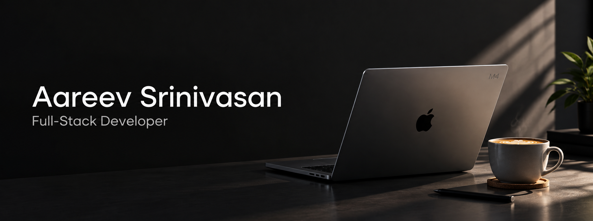

  

  
  
  

---

### About Me 

Second-year engineering undergraduate, full-stack developer, and UI/UX designer focused on building scalable web products and clean digital experiences. 

- **Venture** — Working on and am the Co-founder, CTO & CMO at $\small\textsf{\textbf{fix\color{#FD5803}karu}}$
- **Core Focus** — Full-Stack Development, DSA & Interface Engineering
- **Current Stack** — Building with Go, Rust, PostGRES and modern web architectures with TypeScript & JavaScript
- **Future Roadmap** — Exploring applied Artificial Intelligence & Business with an interest to explore robotics in the future

---

### Venture Details

<table align="center" width="100%">
  <tr>
    <td width="28%" align="center" valign="middle">
      
    </td>
    <td width="72%" valign="middle">
      <h3>fixkaru</h3>
      
On-demand doorstep phone repair with upfront pricing, verified technicians, and phone fixed right in front of you.

      

        
        
      

    </td>
  </tr>
</table>

---

## Projects

<table align="center" width="100%">
  <tr>
    <td width="50%" valign="top">
      <h3>
        <a href="https://github.com/Aareevs/Kestrel-CLI">Kestrel CLI</a> &nbsp;<a href="https://kestrel-cli.vercel.app/" title="Live Website">↗</a>
      </h3>
      
Local-first incident intelligence CLI: isolates root causes, correlates cascading failures with event evidence, and verifies fixes.

      

        
        
      

    </td>
    <td width="50%" valign="top">
      <h3>
        <a href="https://github.com/Aareevs/Nyx">Nyx</a> &nbsp;<a href="https://github.com/Aareevs/Nyx/releases/latest" title="Download Release">↗</a>
      </h3>
      
Native macOS menu bar utility and Dynamic Island for Apple Silicon with modular widget architecture.

      

        
        
        
      

    </td>
  </tr>
  <tr>
    <td width="50%" valign="top">
      <h3>
        <a href="https://github.com/Aareevs/AI_Assistant_Fuli">Fuli</a>
      </h3>
      
Autonomous cross-platform desktop operator and hands-free voice assistant running across macOS, Windows, and Linux.

      

        
        
      

    </td>
    <td width="50%" valign="top">
      <h3>
        Vaani Setu &nbsp;<a href="https://vaani-setu-website.vercel.app" title="Live Web Platform">↗</a>
      </h3>
      
Assistive gesture-to-speech platform built across both a <b>Web Platform</b> and a native <b>Android Mobile App</b>.

      

        
        
        
      

    </td>
  </tr>
</table>

 

---

## Technical Stack

| Currently know | I'm learning |
| :---: | :---: |
|  |  |

---

### **GitHub Stats**

  <table border="0">
    <tr>
      <td>
        
      </td>
      <td>
        
      </td>
    </tr>
  </table>
   
  

---

   “Simplicity is the soul of efficiency.” - Austin Freeman 

   
  

